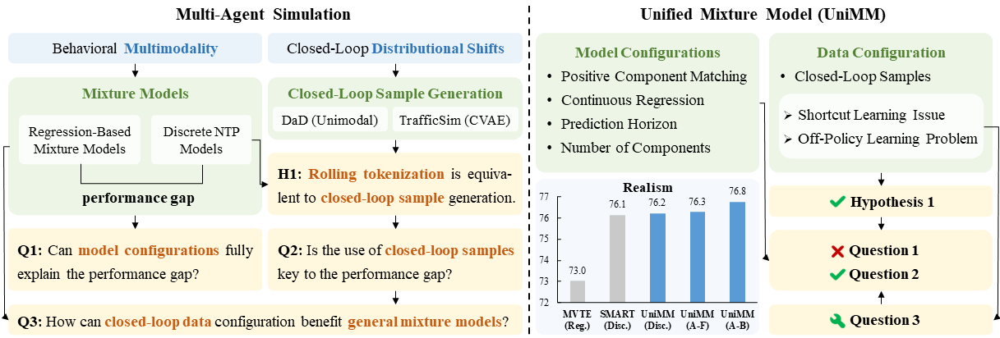
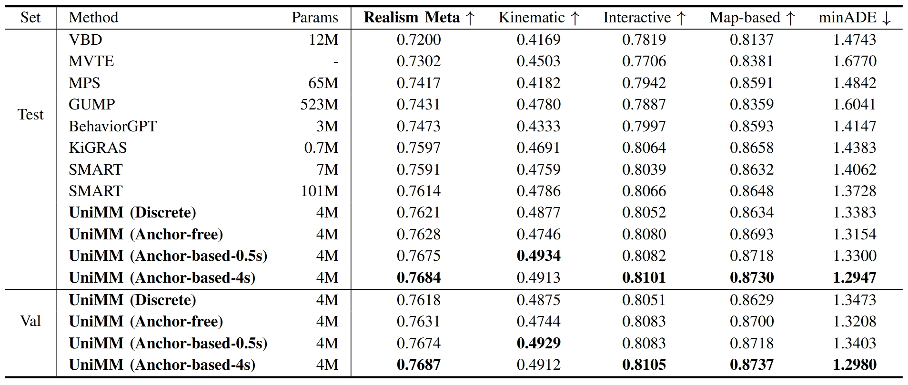

<a id="readme-top"></a>

<div align="center">
  <h1 class="title is-1 publication-title">
    UniMM: A Unified Mixture Model Framework for Multi-Agent Simulation
  </h1>

  <p>
    <a href="https://longzhong-lin.github.io/unimm-webpage">
      
    </a>
    <a href="https://arxiv.org/pdf/2501.17015">
      
    </a>
  </p>
  
  <div class="is-size-5 publication-authors">
    <span class="author-block">
    <a href="https://scholar.google.com/citations?user=1rz42gIAAAAJ&hl=en" target="_blank">Longzhong Lin</a><sup>1,2</sup>,</span>
    <span class="author-block">
    <a href="https://scholar.google.com/citations?user=pfXQwcQAAAAJ&hl=en" target="_blank">Xuewu Lin</a><sup>2</sup>,</span>
    <span class="author-block">
    <a href="https://xukechun.github.io" target="_blank">Kechun Xu</a><sup>1</sup>,</span>
    <span class="author-block">
    <a href="https://scholar.google.com.hk/citations?user=dNAbVgIAAAAJ&hl=zh-CN" target="_blank">Haojian Lu</a><sup>1</sup>,</span>
    <span class="author-block">
    <a href="https://scholar.google.com/citations?user=F2e_jZMAAAAJ&hl=en" target="_blank">Lichao Huang</a><sup>2</sup>,</span>
    <span class="author-block">
    <a href="https://scholar.google.com/citations?user=1hI9bqUAAAAJ&hl=en" target="_blank">Rong Xiong</a><sup>1</sup>,</span>
    <span class="author-block">
    <a href="https://ywang-zju.github.io" target="_blank">Yue Wang</a><sup>1</sup>
    </span>
  </div>

  <div class="is-size-5 publication-authors">
    <span class="author-block"><sup>1</sup>Zhejiang University, <sup>2</sup>Horizon Robotics</span>
  </div>

  
  
</div>


## Abstract
**Simulation** plays a crucial role in assessing autonomous driving systems, where the generation of realistic **multi-agent behaviors** is a key aspect.
In multi-agent simulation, the primary challenges include behavioral **multimodality** and closed-loop **distributional shifts**.
In this study, we formulate a **unified mixture model (UniMM)** framework for generating multimodal agent behaviors, which can cover the mainstream methods including regression-based mixture models and discrete NTP models.
Furthermore, we introduce a **closed-loop sample generation** approach tailored for mixture models to mitigate distributional shifts.
Within the UniMM framework, we recognize critical configurations from both the model and data perspectives.
We conduct a systematic examination of various model configurations, and comprehensively characterize their effects.
Moreover, our investigation into the data configuration highlights the pivotal role of closed-loop samples in achieving realistic simulations.
To extend the benefits of closed-loop samples across a broader range of mixture models, we further introduce a **temporal disentanglement-and-alignment mechanism** to address the shortcut learning and off-policy learning issues.
Leveraging insights from our exploration, the **distinct variants** proposed within the UniMM framework, including discrete, anchor-free, and anchor-based models, all achieve **state-of-the-art** performance on the WOSAC benchmark.


## News

[2026-06] Our [UniMM paper](https://doi.org/10.1109/TPAMI.2026.3700402) has been accepted by IEEE Transactions on Pattern Analysis and Machine Intelligence (TPAMI)!

[2026-06] Code has been released.

[2025-06] We're thrilled to share that [UniMM](https://storage.googleapis.com/waymo-uploads/files/research/2025%20Technical%20Reports/2025%20WOD%20Sim%20Agents%20Challenge%20-%20Honorable%20Mention%20-%20UniMM.pdf) has received an Honorable Mention in the [Waymo Open Sim Agents Challenge (WOSAC) 2025](https://waymo.com/open/challenges/)! Huge thanks to the organizers and congratulations to all the amazing teams!

[2025-01] The paper has been released on [arXiv](https://arxiv.org/pdf/2501.17015).  


## Installation

```
conda create -n unimm python=3.10
conda activate unimm
bash install.sh
```


## Dataset Preparation

1. Download the [Waymo Open Motion Dataset](https://waymo.com/open/), and organize the data as follows.

```
UniMM
├── data
│   ├── waymo
│   │   ├── proto_v1.1
│   │   │   ├── training
│   │   │   ├── validation
│   │   │   ├── testing
├── ...
```

2. Preprocess the dataset, including the `training`, `validation`, and `testing` splits.

```
# training split
python data_preprocess.py --raw_data_path ./data/waymo/proto_v1.1 --output_path ./data/waymo/processed --split training --num_workers 16

# validation split
python data_preprocess.py --raw_data_path ./data/waymo/proto_v1.1 --output_path ./data/waymo/processed --split validation --num_workers 16

# testing split
python data_preprocess.py --raw_data_path ./data/waymo/proto_v1.1 --output_path ./data/waymo/processed --split testing --num_workers 16
```

After preprocessing the dataset, the `data` directory will be as follows.

```
UniMM
├── data
│   ├── waymo
│   │   ├── proto_v1.1
│   │   ├── processed
│   │   │   ├── processed_scenarios_training
│   │   │   ├── processed_scenarios_validation
│   │   │   ├── processed_scenarios_testing
│   │   │   ├── processed_scenarios_training_infos.pkl
│   │   │   ├── processed_scenarios_validation_infos.pkl
│   │   │   ├── processed_scenarios_testing_infos.pkl
├── ...
```


## Training

Below are example commands for training different variants.
For reference, training **UniMM (Discrete)** on the *full* training set using **8 NVIDIA 4090 GPUs** takes approximately **2 to 3 days**.

- UniMM (Discrete)
```
python train.py \
  --root ./data/waymo/processed --experiment unimm_discrete \
  --anchor_file anchors/2048_anchor-trajs_waymo_10Hz-8s_kmeans.npy \
  --num_map_layers 1 --num_agent_layers 2 \
  --num_historical_steps 11 --num_prediction_steps 5 \
  --key_frame_interval 5 --num_execution_steps 5 --train_sim_steps 16 \
  --train_batch_size 4 --val_batch_size 4 --test_batch_size 4 \
  --devices 8 \
  --max_epochs 30
```

- UniMM (Anchor-Free)
```
python train.py \
  --root ./data/waymo/processed --experiment unimm_anchor-free \
  --anchor_free --num_modes 6 --reg_decoder mlp \
  --num_map_layers 1 --num_agent_layers 2 \
  --num_historical_steps 11 --num_prediction_steps 40 \
  --key_frame_interval 5 --num_execution_steps 5 --train_sim_steps 16 \
  --match_execution \
  --train_batch_size 4 --val_batch_size 4 --test_batch_size 4 \
  --devices 8 \
  --max_epochs 30
```

- UniMM (Anchor-Based-0.5s)
```
python train.py \
  --root ./data/waymo/processed --experiment unimm_anchor-based-0.5s \
  --anchor_file anchors/2048_anchor-trajs_waymo_10Hz-8s_kmeans.npy \
  --reg_decoder mlp --approx_posterior \
  --num_map_layers 1 --num_agent_layers 2 \
  --num_historical_steps 11 --num_prediction_steps 5 \
  --key_frame_interval 5 --num_execution_steps 5 --train_sim_steps 16 \
  --train_batch_size 4 --val_batch_size 4 --test_batch_size 4 \
  --devices 8 \
  --max_epochs 30
```

- UniMM (Anchor-Based-4s)
```
python train.py \
  --root ./data/waymo/processed --experiment unimm_anchor-based-4s \
  --anchor_file anchors/2048_anchor-trajs_waymo_10Hz-8s_kmeans.npy \
  --reg_decoder mlp --approx_posterior \
  --num_map_layers 1 --num_agent_layers 2 \
  --num_historical_steps 11 --num_prediction_steps 40 \
  --key_frame_interval 5 --num_execution_steps 5 --train_sim_steps 16 \
  --match_execution --align_match \
  --train_batch_size 4 --val_batch_size 4 --test_batch_size 4 \
  --devices 8 \
  --max_epochs 30
```


## Inference
We provide the `inference_demo.ipynb` notebook as an example for model inference, scenario visualization, and metric calculation.


## Results
Different variants within the UniMM framework achieve state-of-the-art performance on the [WOSAC benchmark](https://waymo.com/open/challenges/2024/sim-agents/).



## Citation
If you find this work useful in your research, please consider citing us:
```
@misc{lin2025revisitmixturemodelsmultiagent,
      title={Revisit Mixture Models for Multi-Agent Simulation: Experimental Study within a Unified Framework}, 
      author={Longzhong Lin and Xuewu Lin and Kechun Xu and Haojian Lu and Lichao Huang and Rong Xiong and Yue Wang},
      year={2025},
      eprint={2501.17015},
      archivePrefix={arXiv},
      primaryClass={cs.AI},
      url={https://arxiv.org/abs/2501.17015}, 
}
```


## :heart: We thank the following GitHub repositories for their valuable reference code
- MTR: https://github.com/sshaoshuai/MTR
- QCNet: https://github.com/ZikangZhou/QCNet